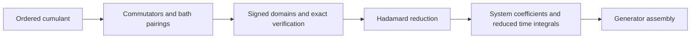

# Arbitrary-order symbolic TCL compiler

The symbolic compiler accepts any positive even perturbative order `2N`.
It uses the same centered Gaussian bath and single system-coupling operator
conventions as the TCL6 derivation. The bath correlation remains symbolic;
no exponential fit is required.

The implementation constructs the complete ordered cumulant, proves the
signed integration-domain decomposition, eliminates one time integral per
bath pair, and collects the resulting Hadamard expressions. An optional
matrix-index stage produces scalar time sums for any finite system dimension.
The fast numerical solver exposed by `fasttcl.solve` continues to support
TCL2, TCL4, and TCL6. The symbolic compiler is a separate interface.

## Compilation steps



The public scripts in [A-Beta-in-Iceland/TCL](https://github.com/A-Beta-in-Iceland/TCL)
implement the TCL6 symbolic workflow. This compiler parameterizes the source,
integration domains, retained time labels, and matrix-index expansion by
`2N`, extending that workflow to arbitrary positive even order. It reduces
`2N-1` ordered integrations to `N-1` integrations. The scalar stage separates
system coefficients from the remaining time-dependent factors and assembles
the outer commutator and Hermitian completion.

## Run

From the repository root, with the project's Python dependencies installed:

```powershell
python -m fasttcl.symbolic --order 4 --dimension 2 --output generated/tcl4-symbolic-v1
python -m fasttcl.symbolic --order 8 --output generated/tcl8-symbolic-v1
python -m fasttcl.symbolic --order 10 --estimate
```

Replace `--order` with the desired even order. `--estimate` prints the number
of projected moment structures and raw Liouvillian/Wick contributions without
expanding them. Omit `--estimate` to compile that order. There is no fixed
maximum order, but full source generation and scalar-index enumeration grow
combinatorially and remain limited by available time and memory.

After package installation, `fasttcl-symbolic` invokes the same CLI.
Install the GitHub source with `python -m pip install .` before running either command.

The output directory must be new or empty. A successful compilation writes:

| Artifact | Content |
|---|---|
| `cumulant-source.jsonl` | Exact oriented-correlation groups for the pre-wrapper |
| `pairing-plans.jsonl` | Signed bounds and exact domain proof results |
| `hr-terms.jsonl` | Collected Hadamard expressions, integer coefficients, and lineage |
| `scalar-source.jsonl` | Optional scalar sums for the pre-wrapper |
| `scalar-outer-raw.jsonl` | Optional scalar sums after the outer commutator |
| `scalar-generator.jsonl` | Optional complete complex-linear generator coefficient |
| `manifest.json` | Order, checks, counts, artifact hashes, and scope |

The manifest is written only after all requested stages succeed. A failed
proof, work limit, or interrupted compilation cannot produce a successful
manifest. `--max-certificate-nodes` sets an optional exact-proof work limit;
exceeding it raises an error, never an approximate certificate.

`--verify-exhaustive` additionally compares the domain identity against all
`(2N-1)!` strict time orderings using the independent legacy oracle. This is
primarily useful at low order. The default verifier instead branches on
unresolved time comparisons, propagates transitive order constraints, and
cancels identical signed regions. It proves the same identity exactly without
materializing the chamber universe. The identity is away from time-coincidence
boundaries; the numerical quadrature must supply its boundary weights.

## Python API

```python
from fasttcl.symbolic import derive_tcl_reduction, compile_scalar_terms

reduction = derive_tcl_reduction(4)
scalar = compile_scalar_terms(
    ((term.coefficient, term.expression)
     for term in reduction.collection.survivors),
    order=reduction.order,
    dimension=3,
)
generator = scalar.outer_raw().hermitian_completion()
payload = generator.payload()
```

The reduced object is the pre-wrapper `S`, with
`K = -[A(t), S] + H.c.` for a Hermitian state. Scalar Hermitian completion
uses realigned conjugation of the coefficient array, so it also defines a
complex-linear map on non-Hermitian matrix units.

Each scalar signature contains output/input indices, `N` gap-phase vectors
with exact integer coefficients of the system energies, and `N` Gamma matrix
entries. Each Gamma argument is a signed contiguous interval of gaps.
Transpose exchanges its matrix indices. Its system coefficient is a collected
polynomial in coupling-matrix entries with integer multiplicities. Coupling
amplitudes and energies are not rounded or substituted during compilation.

For a known sparse coupling matrix, `coupling_support=frozenset({(0,1),(1,0)})`
avoids enumerating structurally zero paths. The CLI accepts the same support
through `--coupling-support support.json`, where the file contains
`[[0,1],[1,0]]`. Entries outside the declared support must actually vanish in
any subsequent numerical evaluation.

Canonical retained times are `t_a,...,t_z,t_aa,...`; there is no alphabetic
ceiling. The current time `t` is distinct from the retained time `t_t`.
Generic artifact schemas include the order explicitly and do not alter the
historical TCL6 JSON schema or TCL8 four-gap records.

## Verification and numerical scope

The tests cover complete TCL2/TCL4/TCL6 construction and exact exhaustive
domain cross-checks, all 706 connected TCL10 pairing plans, higher-order
Hadamard branches, and labels beyond 26 retained times. Scalar tests compare
against direct matrix evaluation, including complex matrices, signed kernel
arguments, transposes, and non-Hermitian input matrix units. Representative
TCL8 scalar output is compared with a frozen result from the previous
two-level implementation.

The complete TCL8 source and reduced inventory can also be checked against
frozen SHA-256 digests of the prior TCL8 derivation. This comparison covers
all 592 source records and 15,948 reduced records, including coefficients
and contributor lineage; only the schema-version label is excluded. The
reference digests and the representative scalar fixture are in `tests/fixtures/`.

```powershell
python -m pytest tests/test_general_order_ast.py tests/test_region_identity.py tests/test_tcl_reduction_general.py tests/test_tcl_scalarization.py
python examples/validate_symbolic_tcl8.py
```

Full TCL10-and-higher cumulant inventories are not included in the regression
suite. The high-order tests exercise the generic machinery and complete
TCL10 pairing coverage without requiring those much larger inventories.

The output defines scalar integrands on an `(N-1)`-dimensional ordered
simplex. It does not provide fast convolution algorithms for every possible
higher-order lag pattern. `evaluate_scalar_terms` is a pointwise reference
evaluator, not a time-integrated generator solver. Numerical integration,
quadrature boundary weights, the factor `dt**(N-1)`, and coupling powers remain
the responsibility of the numerical runtime.
